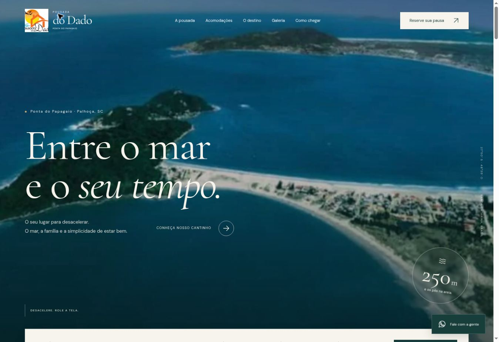

# Pousada do Dado

Site institucional da Pousada do Dado, em Ponta do Papagaio, Palhoça, Santa Catarina.

Página responsiva em português, construída com HTML, CSS e JavaScript, sem dependências de execução ou etapa de compilação.



## Experiência

- Logo obtida do perfil oficial da pousada no Linktree.
- Fotografia aérea da praia e fotos reais das acomodações nos anúncios da pousada no Airbnb.
- Movimento suave no fundo durante a rolagem, entradas de seções e revelação das fotografias.
- Preferência do sistema por movimento reduzido respeitada.
- Acomodações com links próprios para os apartamentos 01, 02 e 03 e para a casa com piscina.
- Galeria com filtros, ampliação, navegação pelo teclado e gesto de deslizar no celular.
- Consulta de datas pelo WhatsApp, com validação de datas e capacidade.
- Links para Airbnb, Booking, Instagram, telefone e rotas no Google Maps.
- Mapa incorporado, perguntas frequentes, navegação móvel e metadados para buscadores.

## Rodar localmente

Na pasta do projeto:

```sh
python3 -m http.server 8000 --directory dist
```

Abra `http://localhost:8000`.

Para verificar a sintaxe do JavaScript, com Node.js instalado:

```sh
node --check dist/app.js
```

## Publicar

O diretório publicável é `dist/`. Ele contém o site completo e pode ser servido por uma hospedagem estática. Não há instalação de pacotes, banco de dados ou variáveis secretas.

A configuração de hospedagem da versão criada no ChatGPT está em `.openai/hosting.json`. Não remova a identidade desse Site ao atualizar a mesma publicação.

## Organização

```text
dist/
  index.html       Conteúdo, formulários, dados estruturados e SVGs dos ícones
  styles.css       Layout responsivo e animações
  app.js           Galeria, menu, formulários e comportamento de rolagem
  assets/          Logo, fotografias e fontes locais
research-assets.json
research-coastal.json
FONT-LICENSES.md
```

## Contato e reservas

O telefone e endereço foram conferidos no perfil público `@pousadadodado`:

- Telefone/WhatsApp: +55 48 99971-2106.
- Rua 200, nº 300, Ponta do Papagaio, Palhoça–SC.
- Instagram: https://www.instagram.com/pousadadodado/
- Links oficiais: https://linktr.ee/pousadadodado

Links dos anúncios utilizados:

- Apartamento 01: https://www.airbnb.com.br/rooms/47890395
- Apartamento 02: https://www.airbnb.com.br/rooms/47986714
- Apartamento 03: https://www.airbnb.com.br/rooms/966058340901944397
- Casa com piscina: https://www.airbnb.com.br/rooms/54104523
- Booking: https://www.booking.com/hotel/br/pousada-do-dado.pt-br.html

O formulário abre uma mensagem preenchida no WhatsApp. O visitante escolhe enviar no aplicativo, e a pousada confirma preços, disponibilidade e reserva. O site não consulta estoque de quartos, não recebe pagamentos e não confirma reservas automaticamente.

A piscina pertence à casa, e não aos apartamentos. As particularidades de escada caracol, capacidade, água e horários são informadas na página e devem ser conferidas no anúncio da unidade escolhida.

## Fotografias e marca

Fotos das acomodações e imagem aérea: anúncios públicos da Pousada do Dado no Airbnb. Logo: imagem do perfil oficial no Linktree. Os direitos desses materiais permanecem com seus respectivos titulares. O reaproveitamento para outros estabelecimentos exige a autorização apropriada.

Não foi possível verificar a data de captura das fotografias dos anúncios. As imagens foram obtidas dos anúncios disponíveis durante a criação do site; isso não significa que tenham sido fotografadas recentemente.

As paisagens de referência têm créditos e licenças indicados no modal “Créditos das fotografias” e em `research-coastal.json`:

- Otávio Nogueira — Ponta do Papagaio, CC BY 2.0, captura em 20/09/2015.
- Eliezer Pedroso — Praia da Pinheira, CC BY 3.0, captura em 22/02/2014.
- Emilio Coatti — Guarda do Embaú, CC BY-SA 3.0, captura em 18/11/2012.

As imagens da região foram apenas redimensionadas e convertidas para WebP. O enquadramento visual varia por CSS conforme a tela. O arquivo original da logo no Linktree já tem o lettering parcialmente cortado nas laterais; a página usa esse arquivo sem reconstruir a marca.

## Verificação

Conferência em navegador em tela de computador e em área de 390 × 844 px: navegação móvel, galeria e filtros, abertura e fechamento de modais, carregamento de imagens e ausência de rolagem horizontal. A validação do formulário foi conferida para grupos acima da capacidade dos apartamentos. Verificações locais de sintaxe JavaScript, caminhos de arquivos, IDs, âncoras e JSON-LD também foram executadas.
